# Sort & Send — Game Design

## Game overview

Sort & Send is a two-step classification game for young learners. Each round reveals two contrasting items in the roller. Two doors show the category labels for that pair. The player selects an item and sends it through its matching door; after a correct answer, the other item automatically travels through its matching door. A completed pair uses one round. A wrong door gives a gentle retry and does not use a round, so children can learn by trying again.

### Modes

| Mode | Rounds | Content pool | Intended feel |
| --- | ---: | ---: | --- |
| Simple | 6 | 8 category pairs | Clear, concrete properties and opposites |
| Moderate | 10 | 12 category pairs | Descriptive and observable classifications |
| Difficult | 15 | 18 category pairs | Science, habitats, material properties, and concepts |

Categories are shuffled at the start. The selected mode has more categories than rounds, so no category repeats within a normal game. Every category now includes three distinct item pairings (the original pair plus two alternate pairs), for 114 available item pairings total: 24 Simple, 36 Moderate, and 54 Difficult. A category is used at most once in a game, and its item pairing is chosen randomly each time.

## State and logic architecture

### State model

```text
mode: simple | moderate | difficult | null
roundIndex: number of successfully completed pairs
score: number of items sorted correctly (two per completed round)
categoryDeck: shuffled, no-repeat category list for this game
activePair: current category labels and two item records, or null
selectedItemIndex: 0 | 1 | null
phase: choose | ready | spinning | select | sorting | over
busy: prevents overlapping spin and sort animations
```

Each item record is `[emoji, accessible display name, doorIndex]`. `doorIndex` is either `0` (the first category/door) or `1` (the second category/door). The `ITEM_VARIANTS` lists hold two extra item pairs per category; one of the three pairs is selected at random when that category is played.

### Round loop pseudocode

```text
on mode selected:
    enable Let’s Go

on start or reset:
    clear active pair and selection
    set roundIndex = 0 and score = 0
    shuffle a copy of this mode’s category list
    set phase = ready
    show the roller and sorting box
    enable Spin

on Spin, only when phase is ready:
    set phase = spinning; lock spin and doors
    animate both vertical reels
    after animation:
        activePair = categoryDeck[roundIndex]
        reveal exactly two distinct items
        set door labels to activePair.categoryA and categoryB
        set phase = select; unlock doors and item buttons

on item tapped, only when phase is select:
    selectedItemIndex = tapped index
    highlight that roller item
    announce its name and prompt the player to choose a door

on door tapped, only when phase is select and an item is selected:
    if selectedItem.doorIndex does not equal tapped door:
        shake the chosen door and show a kind retry message
        keep the same pair, selection, round, and remaining chances
        return

    set phase = sorting; lock all controls
    open the matching door and slide the selected item into it
    remove the selected item from its reel
    open the other item’s matching door
    automatically slide and remove the remaining item
    after both animations:
        score += 2
        roundIndex += 1
        if roundIndex equals this mode’s round count:
            set phase = over
            show the win banner and replay/change-mode actions
        else:
            clear selection and pair
            set phase = ready
            enable Spin for the next pair

on Change Mode:
    clear active round and return to mode selection

on Play Again:
    start a new game in the selected mode with a newly shuffled category deck
```

### Flow diagram

```mermaid
stateDiagram-v2
    [*] --> ChooseMode
    ChooseMode --> Ready: choose mode and start
    Ready --> Spinning: spin
    Spinning --> SelectItem: pair and door labels appear
    SelectItem --> SelectDoor: tap an item
    SelectDoor --> SelectItem: wrong door / gentle retry
    SelectDoor --> AutoSort: correct door
    AutoSort --> Ready: remaining item auto-sorts; rounds remain
    AutoSort --> Win: final round complete
    Win --> Ready: replay
    Ready --> ChooseMode: change mode
```



## Dynamic content database

The production game stores category labels and base items in the `CONTENT` object, and alternate examples in `ITEM_VARIANTS`, both in `index.html`. This gives the game 114 distinct item pairings across its three modes (24 Simple, 36 Moderate, and 54 Difficult). The emoji are the no-download image assets; each description is also used for screen-reader labels and feedback.

### Simple — 8 pairs

| Door 1 | Door 2 | Door 1 item | Door 2 item |
| --- | --- | --- | --- |
| Heavy | Light | 🐘 Elephant | 🪶 Feather |
| Long | Short | 🚂 Long train | ✏️ Short crayon |
| Tall | Short | 🦒 Giraffe | 🐇 Rabbit |
| Living | Non-living | 🌻 Sunflower | 🚗 Toy car |
| Big | Small | 🐋 Whale | 🐜 Ant |
| Hot | Cold | ☕ Hot cocoa | 🧊 Ice cube |
| Hard | Soft | 🪨 Rock | 🧸 Teddy bear |
| Wet | Dry | 💧 Wet sponge | 🧽 Dry sponge |

### Moderate — 12 pairs

| Door 1 | Door 2 | Door 1 item | Door 2 item |
| --- | --- | --- | --- |
| Healthy food | Treat food | 🍎 Apple | 🍟 French fries |
| Fast | Slow | 🐆 Cheetah | 🐌 Snail |
| Loud | Quiet | 🥁 Drum | 🤫 Whisper |
| Shiny | Dull | 🪞 Mirror | 🪵 Unpolished wood |
| Floats | Sinks | 🪵 Cork | 🪨 Stone |
| Smooth | Rough | 🔮 Glass marble | 🌰 Pine cone |
| Sweet | Sour | 🍭 Lollipop | 🍋 Lemon |
| Straight | Curved | 📏 Ruler | 🍌 Banana |
| Day-active | Night-active | 🐓 Rooster | 🦉 Owl |
| Waterproof | Absorbent | ☂️ Raincoat | 🧻 Paper towel |
| Recyclable | Not recyclable | 🥫 Tin can | 🍌 Banana peel |
| Clean | Dirty | ✨ Clean plate | 🧤 Muddy glove |

### Difficult — 18 pairs

| Door 1 | Door 2 | Door 1 item | Door 2 item |
| --- | --- | --- | --- |
| Solid | Liquid | 🧱 Brick | 💧 Water |
| Carnivore | Herbivore | 🦁 Lion | 🦌 Deer |
| Renewable | Non-renewable | ☀️ Sunlight | 🛢️ Petroleum |
| Mammal | Reptile | 🐬 Dolphin | 🦎 Lizard |
| Transparent | Opaque | 🪟 Clear glass | 🪵 Wooden board |
| Tool | Toy | 🔨 Hammer | 🧸 Teddy bear |
| Natural | Man-made | 🍃 Leaf | 🪑 Chair |
| Land habitat | Water habitat | 🐪 Camel | 🐠 Clownfish |
| Magnetic | Non-magnetic | 🧲 Iron nail | 🪵 Wooden spoon |
| Conductor | Insulator | 🔌 Copper wire | 🧤 Rubber glove |
| Water-absorbent | Water-resistant | 🧽 Sponge | 🧥 Rain jacket |
| Biodegradable | Non-biodegradable | 🍂 Dry leaf | 🥤 Plastic cup |
| Plant part | Animal part | 🌱 Root | 🪶 Feather |
| Needs electricity | No electricity needed | 📱 Phone | 📖 Book |
| Can melt easily | Does not melt easily | 🧈 Butter | 🪨 Stone |
| Push | Pull | 🛒 Shopping cart | 🧳 Wagon handle |
| Edible | Not edible | 🥕 Carrot | 🧼 Soap |
| Bendable | Rigid | 🧶 Rubber band | 📐 Metal ruler |

## UI/UX feedback recommendations

### Correct sort

- Highlight the selected item with a bright gold ring, then move it toward the chosen door while the door swings open.
- Give the door a warm glow and a small star burst when the item disappears.
- After a short beat, open the other door and move the second item automatically. Say what category it belongs to so the automatic action reinforces learning.
- Keep the round counter visible and celebrate each completed pair with a short bounce on the counter rather than a blocking popup.
- Use gentle, optional sound effects; all meaning must remain visible in text and motion.

### Incorrect sort

- Keep the item visible and shake the selected door briefly. Use a supportive message such as “Almost! Try another door.”
- Avoid red X marks, penalties, or lost rounds. The goal is category learning, so retry until the child chooses correctly.
- Ensure both item and door buttons have clear focus outlines and accessible names. Respect `prefers-reduced-motion` and provide a touch target of at least 44 CSS pixels.

## Asset generation list

The current implementation is fully local and uses platform emoji, CSS roller/door art, and no image downloads. If custom illustrations are added later, generate these as transparent PNG or SVG assets with consistent thick outlines, friendly expressions, high contrast, and a straight-on view:

1. **Item icon library:** one individual square icon per item in the tables above; keep the item centered, isolated, and readable at 96 × 96 px. Prefer a sprite sheet grouped by mode for easy updates.
2. **Roller frame:** one vertical two-slot wooden-and-painted-metal slot-machine frame, front-facing, with two clear windows and no words or category labels.
3. **Sorting box:** one front-facing warm wooden box with two equal doors, separate empty label plaques above them, and enough contrast for category text.
4. **Door motion frames:** closed, opening, and open states for each door, matching the sorting-box perspective.
5. **Celebration accents:** small star/sparkle/confetti sprites, plus a reusable gentle shake/bounce animation; these can remain CSS effects.
6. **Mode badges:** simple, moderate, and difficult playful badges, without embedded text so labels remain localizable.
7. **Win banner:** a reusable celebratory banner with clear empty space for live text and replay controls; keep controls as HTML, not baked into the image.

## Implementation notes

- `index.html` is the complete runnable page with embedded CSS, the content data, accessible controls, and game logic.
- `docs/index.html` contains the Home page card linking to `sort-and-send/index.html`.
- A reset restarts the current mode. “Change Mode” returns to the mode chooser. The content rotates categories without repeats for the length of each selected game.
